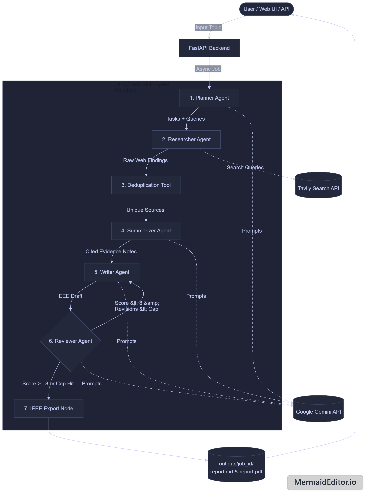
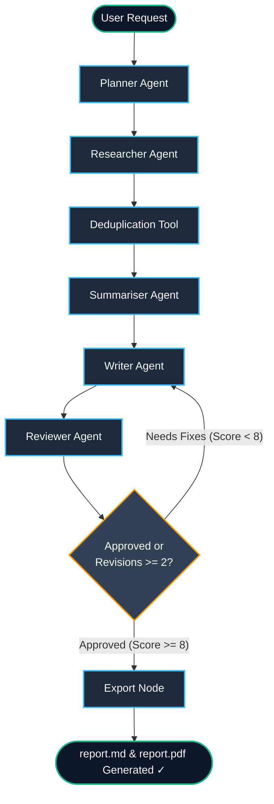
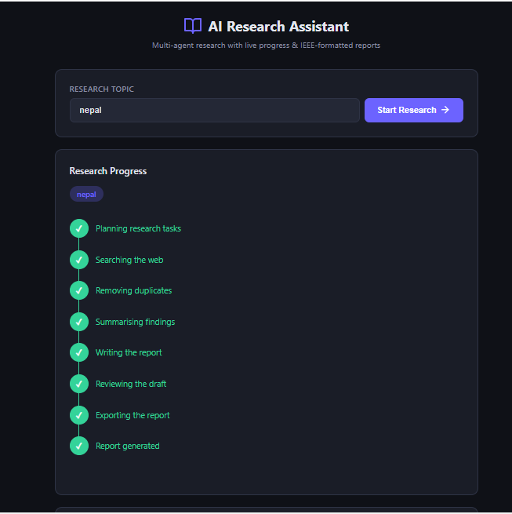
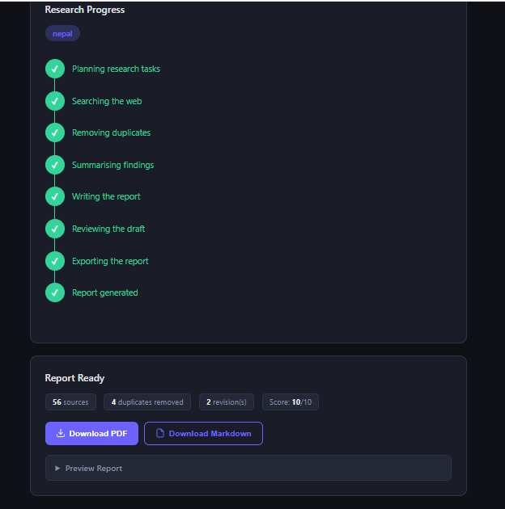

# 🔬 AI Research Assistant — Autonomous Multi-Agent Research System

[](https://www.python.org/)
[](https://fastapi.tiangolo.com/)
[](https://langchain-ai.github.io/langgraph/)
[](https://ai.google.dev/)
[](https://tavily.com/)
[](https://www.docker.com/)
[](https://opensource.org/licenses/MIT)

> **An end-to-end autonomous research engine built from the ground up.** Given any research topic, the system automatically plans multi-angle investigations, gathers live web intelligence from multiple sources, eliminates redundant information, synthesizes findings, writes a peer-reviewed technical report with verified citations, and exports publication-ready **Markdown** and **PDF** documents.

---

## 📑 Table of Contents

- [Project Overview & Objective](#-project-overview--objective)
- [Core Features](#-core-features)
- [Multi-Agent Architecture](#-multi-agent-architecture)
- [Agentic Workflow & State Graph](#-agentic-workflow--state-graph)
- [Project Directory Structure](#-project-directory-structure)
- [Installation & Quickstart](#-installation--quickstart)
- [Environment Configuration](#-environment-configuration)
- [Docker Deployment](#-docker-deployment)
- [API Documentation & Usage](#-api-documentation--usage)
- [Sample Output & Report Standards](#-sample-output--report-standards)
- [Deliverables Checklist](#-deliverables-checklist)
- [Author & License](#-author--license)

---

## 🎯 Project Overview & Objective

This project was designed, developed, and implemented by me to fulfill the requirements of **Project 1: AI Research Assistant**. It demonstrates the foundational paradigms of modern **Agentic AI**:

1. **Autonomous Planning & Reasoning:** Breaking open-ended human topics into granular, logically structured research questions.
2. **Tool Use & Web Retrieval:** Programmatically searching the live web across diverse reputable sources.
3. **Deduplication & Information Synthesis:** Identifying content overlap using mathematical NLP techniques and synthesizing dense source excerpts.
4. **Drafting & Peer-Review Collaboration:** A multi-agent feedback loop where an independent reviewer agent critiques drafts and triggers automated revisions before publication.
5. **Multi-Format Document Generation:** Exporting IEEE/academic-grade reports with linked citations in both raw Markdown and styled PDF formats.

---

## ✨ Core Features

| Feature | Description | Implementation Details |
|---|---|---|
| **Research Topic Input** | Submit any broad or narrow topic via REST API, Swagger UI, or the included web dashboard. | FastAPI endpoint `POST /api/research` with input validation via Pydantic. |
| **Research Planning** | AI decomposes the topic into 4–6 distinct investigation axes with targeted web search queries. | `Planner Agent` producing strict JSON execution plans. |
| **Multi-Source Research** | Concurrently fetches live web data across search engines for every planned task. | `Research Agent` querying the Tavily Search API with advanced search depth. |
| **Duplicate Detection** | Eliminates duplicate or near-duplicate articles gathered from overlapping search queries. | `Deduplication Tool` utilizing URL canonicalization and TF-IDF Cosine Similarity ($threshold = 0.85$). |
| **Information Summarization** | Condenses source extracts into verified bullet-point findings per research question. | `Summariser Node` enforcing strict non-hallucination rules and citation tagging. |
| **Report Generation** | Composes a technical paper structured with Abstract, Introduction, Body sections, and Conclusion. | `Writer Agent` following IEEE conference paper typography and roman-numeral sectioning. |
| **Citation Traceability** | Strict bracket citations `[1]`, `[2]` linked directly to verified sources in a dedicated References section. | Automated bibliographic index mapping with hyperlinked sources. |
| **Reviewer Feedback Loop** | Evaluates drafts for factual integrity, completeness, and phantom citation detection. | `Reviewer Agent` scoring from 1–10; triggers up to 2 automated revision cycles. |
| **Dual-Format Export** | Produces both clean, portable `.md` files and publication-grade `.pdf` documents. | Native markdown export coupled with `xhtml2pdf` CSS styling (Times Roman, formal margins). |

---

## 🤖 Multi-Agent Architecture

The system is engineered as a collaborative multi-agent collective orchestrated via **LangGraph**:

```
                         ┌──────────────────────────────────────────────┐
                         │               USER INPUT                     │
                         │   Topic: "AI in Healthcare Diagnostics"      │
                         └──────────────────────┬───────────────────────┘
                                                │
                                                ▼
                         ┌──────────────────────────────────────────────┐
                         │               PLANNER AGENT                  │
                         │   • Decomposes topic into 4-6 sub-tasks      │
                         │   • Generates 2 search queries per task      │
                         └──────────────────────┬───────────────────────┘
                                                │
                                                ▼
                         ┌──────────────────────────────────────────────┐
                         │              RESEARCHER AGENT                │
                         │   • Executes Tavily web searches             │
                         │   • Extracts titles, URLs, and text blocks   │
                         └──────────────────────┬───────────────────────┘
                                                │
                                                ▼
                         ┌──────────────────────────────────────────────┐
                         │             DEDUPLICATION TOOL               │
                         │   • Canonicalizes URLs                       │
                         │   • TF-IDF cosine similarity filtering       │
                         └──────────────────────┬───────────────────────┘
                                                │
                                                ▼
                         ┌──────────────────────────────────────────────┐
                         │              SUMMARISER AGENT                │
                         │   • Synthesizes task-specific notes          │
                         │   • Assigns numeric source tags [1], [2]...  │
                         └──────────────────────┬───────────────────────┘
                                                │
                                                ▼
                         ┌──────────────────────────────────────────────┐
                         │                WRITER AGENT                  │
                         │   • Assembles full technical manuscript      │
                         │   • Adheres to IEEE paper structure          │
                         └──────────────────────┬───────────────────────┘
                                                │
                                                ▼
                         ┌──────────────────────────────────────────────┐
                         │               REVIEWER AGENT                 │
                         │   • Evaluates completeness & citations       │
                         │   • Checks score >= 8 or revision cap        │
                         └──────────────┬───────────────────────────────┘
                                        │
                         ┌──────────────┴──────────────┐
                         │                             │
                   [Issues Found &              [Approved or
                  Revisions < Max]           Revision Cap Met]
                         │                             │
                         ▼                             ▼
                ┌─────────────────┐          ┌───────────────────┐
                │ Re-draft Writer │          │    EXPORT NODE    │
                │  with critique  │          │ • Build References│
                └─────────────────┘          │ • Save report.md  │
                                             │ • Render report.pdf│
                                             └───────────────────┘
```

## Project Architecture

<p align="center">
  
</p>


### Agent Roles & Specifications

1. **Planner Agent (`app/agents/planner.py`)**  
   Analyzes the user's topic and creates a structured execution blueprint containing targeted sub-questions and optimized search queries.
2. **Researcher Agent (`app/agents/researcher.py`)**  
   Queries external search engines via Tavily API, tagging every raw excerpt with its parent sub-task ID.
3. **Deduplication Engine (`app/tools/dedup.py`)**  
   Performs two-stage filtering: exact URL normalization followed by scikit-learn TF-IDF vectorization to drop redundant information above the similarity threshold.
4. **Summarizer Node (`app/agents/researcher.py`)**  
   Distills raw search results into concise bulleted evidence points, strictly binding claims to source indices.
5. **Writer Agent (`app/agents/writer.py`)**  
   Drafts a complete paper containing Title, Abstract, Roman-numeral body sections, and Conclusion. Written in third-person technical style without placeholder fluff.
6. **Reviewer Agent (`app/agents/reviewer.py`)**  
   Performs regex-based citation extraction, checks cited indices against valid source IDs, scores formatting, and produces an actionable critique.
7. **Export Engine (`app/export/pdf.py` & `app/graph.py`)**  
   Compiles the final bibliography, writes `report.md`, and renders `report.pdf` using CSS print media stylesheets.

---

## 🔄 Agentic Workflow & State Graph

The orchestration is implemented using a compiled **LangGraph `StateGraph`**:



---

## 📁 Project Directory Structure

```
Researching-Agent/
├── app/                           # Core Application Package
│   ├── agents/                    # Autonomous AI Agents
│   │   ├── __init__.py
│   │   ├── planner.py             # Topic decomposition & query planning
│   │   ├── researcher.py          # Tavily search integration & task summarisation
│   │   ├── reviewer.py            # Quality audit, citation validation & feedback
│   │   └── writer.py              # Academic report generation & revision drafting
│   ├── export/                    # Document Rendering Engines
│   │   ├── __init__.py
│   │   └── pdf.py                 # xhtml2pdf HTML/CSS to PDF compilation
│   ├── static/                    # Dashboard Frontend Assets
│   │   ├── app.js                 # Real-time polling & UI update controller
│   │   ├── index.html             # Research submission portal & viewer
│   │   └── style.css              # Dark-mode responsive styling
│   ├── tools/                     # Utility Tools
│   │   ├── __init__.py
│   │   ├── dedup.py               # TF-IDF Cosine similarity deduplicator
│   │   └── search.py              # Tavily Search API client wrapper
│   ├── config.py                  # Dynamic configuration loader (.env)
│   ├── graph.py                   # LangGraph workflow & export orchestration
│   ├── llm.py                     # Universal OpenAI-compatible LLM gateway with retries
│   └── main.py                    # FastAPI application, REST endpoints & static routes
├── docs/                          # Project Documentation
│   ├── images/
│   │   └── Architecture.png       # Architecture diagram asset
│   ├── API.md                     # REST API reference and payload schemas
│   └── architecture.md            # Detailed technical specification
├── outputs/                       # Generated Output Artifacts (ignored by git)
│   └── <job_id>/
│       ├── report.md              # Final generated Markdown report
│       └── report.pdf             # Formatted PDF with references
├── .env.example                   # Environment configuration template
├── .gitignore                     # Git ignore rules
├── docker-compose.yml             # Multi-platform Docker Compose service definition
├── Dockerfile                     # Production-ready Python 3.11/3.14 container image
├── requirements.txt               # Pinned Python package dependencies
└── README.md                      # Comprehensive project documentation
```

---

## 🚀 Installation & Quickstart

### Prerequisites
- **Python 3.10+** (tested on 3.11, 3.12, and 3.14)
- **Tavily Search API Key** (free tier available at [app.tavily.com](https://app.tavily.com))
- **LLM API Key** (e.g., Google Gemini from [aistudio.google.com](https://aistudio.google.com/apikey), Groq, or OpenAI)

### 1. Clone & Set Up Virtual Environment

```bash
# Clone the repository
git clone https://github.com/your-username/Researching-Agent.git
cd Researching-Agent

# Create and activate a virtual environment
# Windows (PowerShell):
python -m venv venv
.\venv\Scripts\Activate.ps1

# Linux / macOS:
python3 -m venv venv
source venv/bin/activate
```

### 2. Install Dependencies

```bash
pip install -r requirements.txt
```

### 3. Configure Credentials

Copy the `.env.example` file to create your active configuration:

```bash
cp .env.example .env
```

Open `.env` and fill in your keys:

```ini
# Choose your provider: gemini | groq | openrouter | ollama | anthropic
LLM_PROVIDER=gemini

# API Keys
GEMINI_API_KEY=your_gemini_api_key_here
TAVILY_API_KEY=tvly-your_tavily_search_key_here

# Model Specification (Gemini Flash Lite is fast and free)
LLM_MODEL=gemini-flash-lite-latest

# Optional Agent Tuning
MAX_REVISIONS=2
DEDUP_THRESHOLD=0.85
OUTPUT_DIR=outputs
```

### 4. Run the Application

```bash
uvicorn app.main:app --reload --host 127.0.0.1 --port 8000
```

- **Interactive UI:** Navigate to `http://127.0.0.1:8000`
- **Swagger Documentation:** Navigate to `http://127.0.0.1:8000/docs`
- **Health Check:** `http://127.0.0.1:8000/health`

---

## ⚙️ Environment Configuration

The application features a flexible provider architecture supporting both proprietary and open-source models:

| Provider | `LLM_PROVIDER` | Default `LLM_MODEL` | Required Key |
|---|---|---|---|
| **Google Gemini (Recommended)** | `gemini` | `gemini-flash-lite-latest` | `GEMINI_API_KEY` |
| **Groq (Fast Open-Source)** | `groq` | `llama-3.3-70b-versatile` | `GROQ_API_KEY` |
| **OpenRouter** | `openrouter` | `meta-llama/llama-3.3-70b-instruct:free` | `OPENROUTER_API_KEY` |
| **Ollama (Local Offline)** | `ollama` | `llama3.1` | None (`http://localhost:11434/v1`) |
| **Anthropic** | `anthropic` | `claude-sonnet-5-5` | `ANTHROPIC_API_KEY` |

---

## 🐳 Docker Deployment

The system is fully containerized for zero-dependency local or cloud deployment.

### Using Docker Compose (Recommended)

```bash
# Start the containerized assistant in detached mode
docker compose up -d --build

# View real-time logs
docker compose logs -f

# Stop the application
docker compose down
```

### Using Docker CLI Directly

```bash
# Build the container image
docker build -t ai-research-assistant .

# Run container mapping port 8000 and passing environment file
docker run -d -p 8000:8000 --env-file .env --name research-assistant ai-research-assistant
```

Access the interface at `http://localhost:8000`.

---

## 📡 API Documentation & Usage

### 1. Submit a Research Topic
Initiates an asynchronous background job and immediately returns a job ticket.

**Request:**
```bash
curl -X POST "http://127.0.0.1:8000/api/research" \
     -H "Content-Type: application/json" \
     -d '{"topic": "Impact of Artificial Intelligence on Modern Healthcare"}'
```

**Response (`202 Accepted`):**
```json
{
  "job_id": "d1f951d71524",
  "status": "queued",
  "status_url": "/api/research/d1f951d71524"
}
```

---

### 2. Poll Research Progress
Poll the job status to display real-time stage transitions.

**Request:**
```bash
curl "http://127.0.0.1:8000/api/research/d1f951d71524"
```

**Response (`200 OK` - While Running):**
```json
{
  "job_id": "d1f951d71524",
  "topic": "Impact of Artificial Intelligence on Modern Healthcare",
  "status": "running",
  "stage": "summarising",
  "stage_label": "Summarising findings…",
  "agent": "summariser",
  "stage_elapsed_seconds": 14
}
```

**Response (`200 OK` - Upon Completion):**
```json
{
  "job_id": "d1f951d71524",
  "topic": "Impact of Artificial Intelligence on Modern Healthcare",
  "status": "completed",
  "stage": "completed",
  "stage_label": "Report generated ✓",
  "title": "Artificial Intelligence in Healthcare: Comprehensive Research Report",
  "sources_used": 37,
  "duplicates_removed": 13,
  "revisions": 1,
  "md_path": "outputs/d1f951d71524/report.md",
  "pdf_path": "outputs/d1f951d71524/report.pdf"
}
```

---

### 3. Download Generated Reports

**Download PDF Document:**
```bash
curl -O -J "http://127.0.0.1:8000/api/research/d1f951d71524/download/pdf"
```

**Download Markdown Document:**
```bash
curl -O -J "http://127.0.0.1:8000/api/research/d1f951d71524/download/md"
```

---


### Demo images of agent work
<p align="center">
  
</p>

<p align="center">
  
</p>


## 📄 Sample Output & Report Standards

Every generated report adheres to academic/industry paper guidelines:

```markdown
# Artificial Intelligence in Healthcare: Comprehensive Research Report

## Abstract
Artificial intelligence (AI) has evolved significantly since foundational milestones in the 1950s, 
transitioning from early expert systems to modern deep learning architectures [1]. Today, AI is 
embedded throughout the healthcare industry, revolutionizing diagnostics, personalized medicine, 
clinical workflows, and drug discovery [1, 25]...

## I. INTRODUCTION
The integration of artificial intelligence into medicine represents a profound transformation in how 
healthcare is researched, delivered, and managed [1]...

## II. CURRENT SCOPE, KEY PLAYERS, AND TRANSFORMATION IN DIAGNOSTICS
The current scope of AI in healthcare spans diagnostics, specialized clinical fields, drug discovery, 
and care workflows [1]. Diagnostic accuracy in oncology has increased through convolutional imaging [25]...

## III. REGULATORY, ETHICAL, AND PRIVACY CHALLENGES
The FDA classifies diagnostic algorithms as Software as a Medical Device (SaMD) [1]. Major barriers 
include algorithmic bias, algorithmic drift, and clinical transparency [1]...

## IV. CONCLUSION
The global healthcare AI market is projected to expand significantly by 2032 [42]. AI will augment, 
rather than replace, human clinicians, automating administrative overhead and expanding access...

## REFERENCES
[1] Artificial intelligence in healthcare and medicine, https://pmc.ncbi.nlm.nih.gov/articles/PMC12455834
[2] Evolution of AI in Healthcare | Xsolis, https://www.xsolis.com/blog/the-evolution-of-ai-in-healthcare
[25] Applications of AI in Medicine, https://www.xiahepublishing.com/2472-0712/ERHM-2023-00048
[42] AI in Healthcare: Market Outlook & Innovations, https://www.healthleadersmedia.com/...
```

---

## ✅ Deliverables Checklist

- [x] **Complete Source Code:** Full multi-agent implementation with clean separation of concerns in `app/`.
- [x] **Setup Instructions:** Step-by-step guides for local virtual environment and container execution.
- [x] **Project Overview:** Clear documentation of agentic concepts, tools, and algorithms.
- [x] **Architecture Diagram:** Interactive Mermaid workflow diagram and system layout.
- [x] **API Documentation:** Comprehensive endpoint descriptions with example requests/responses in `docs/API.md`.
- [x] **Docker Configuration:** Production-ready `Dockerfile` and `docker-compose.yml`.
- [x] **All Mandatory Features Implemented:** Topic input, planning, multi-source search, duplicate removal, summarization, IEEE report drafting, citations, and dual-format export.
- [x] **All Stretch Goals Implemented:** Multi-agent collective (Planner, Researcher, Writer, Reviewer) orchestrated via LangGraph.

---

## 👤 Author & License

- **Developer:** Intern / Independent AI Engineer
- **Project:** AI Research Assistant (Multi-Agent System)
- **License:** Distributed under the **MIT License**. See `LICENSE` for details.
