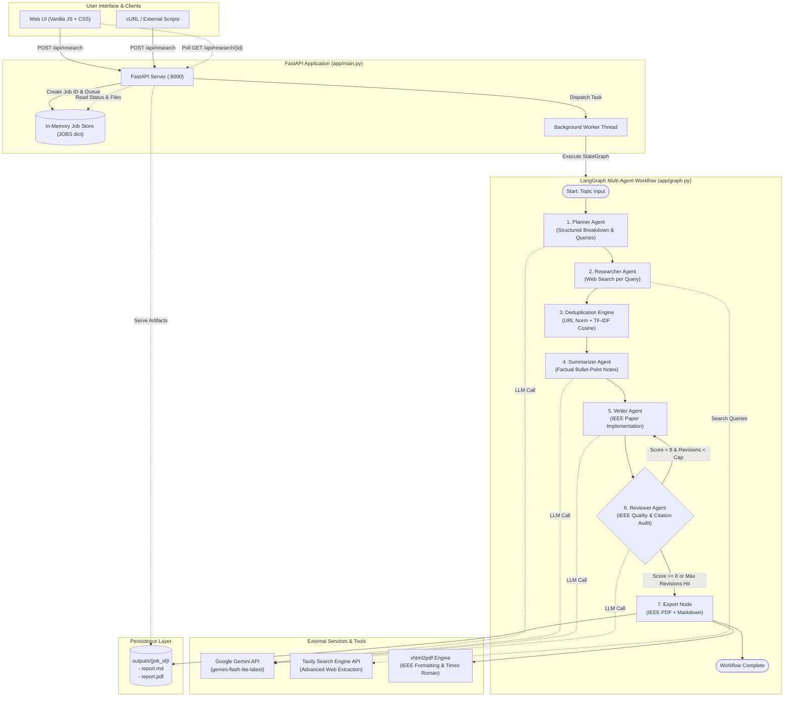
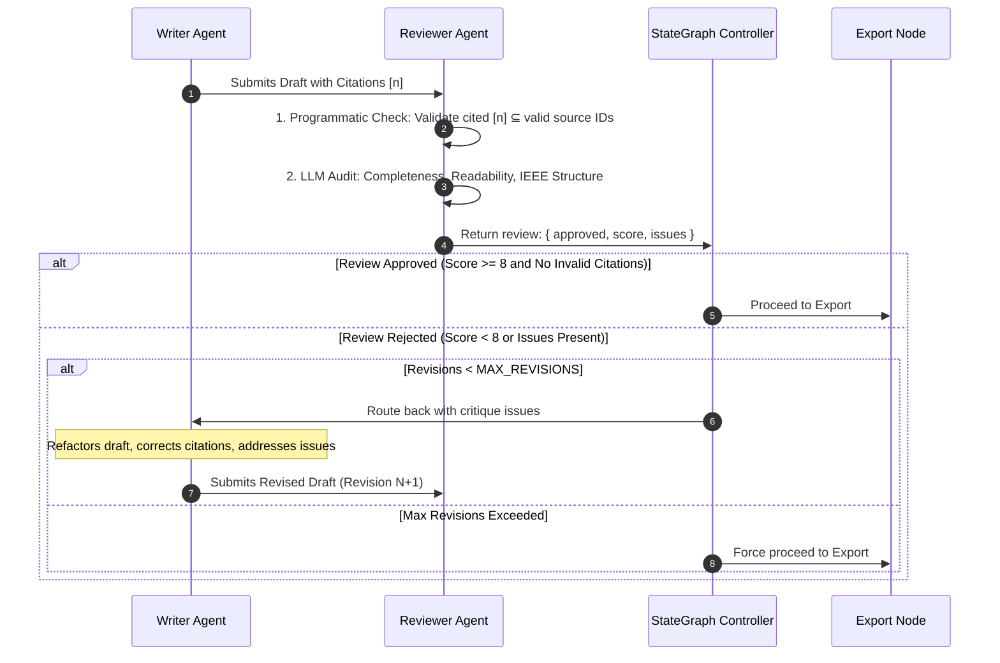

# AI Research Assistant – Architecture & System Design

## 1. High-Level Architecture

The **AI Research Assistant** is an autonomous, multi-agent research workflow built with **LangGraph**, **FastAPI**, and **Google Gemini** (via its OpenAI-compatible endpoint). It transforms a user-provided research topic into an academic, IEEE-formatted technical research paper through collaborative planning, web search, deduplication, summarization, writing, peer review, and PDF generation.

---

## 2. Core Agent Modules & Responsibilities

| Agent / Node | Primary Responsibility | Input State | Output State | Key File |
|---|---|---|---|---|
| **Planner Agent** | Decomposes topic into 4–6 IEEE-oriented research questions and paired search queries. | `topic` | `title`, `plan`, `stage: "planning"` | `app/agents/planner.py` |
| **Researcher Agent** | Executes multi-query web search via Tavily, tagging results with task IDs. | `plan` | `raw_results`, `stage: "searching"` | `app/agents/researcher.py` |
| **Deduplication Engine** | Normalizes URLs and computes TF-IDF cosine similarity to eliminate redundant findings. | `raw_results` | `sources`, `duplicates_removed`, `stage: "deduplicating"` | `app/tools/dedup.py` |
| **Summarizer Node** | Synthesizes sources per research question, attributing every claim to stable citation indices `[n]`. | `plan`, `sources` | `notes`, `stage: "summarising"` | `app/agents/researcher.py` |
| **Writer Agent** | Implements the draft following IEEE conference paper conventions (Roman numerals, Abstract, Conclusion). | `title`, `plan`, `notes`, `sources`, `review` | `draft`, `revisions`, `stage: "writing"` | `app/agents/writer.py` |
| **Reviewer Agent** | Evaluates completeness, citation validity, and style. Rejects drafts citing non-existent sources. | `draft`, `sources` | `review`, `stage: "reviewing"` | `app/agents/reviewer.py` |
| **Export Node** | Appends IEEE-compliant References (each on a new line) and compiles Markdown and PDF. | `draft`, `sources`, `job_id` | `report`, `md_path`, `pdf_path`, `stage: "completed"` | `app/export/pdf.py`, `app/graph.py` |

---

## 3. The Writer ⇄ Reviewer Feedback Loop

The iterative refinement loop ensures publication-grade quality and strict citation hygiene:

---

## 4. IEEE Standard Formatting Specification

The export subsystem enforces IEEE technical publication guidelines:

* **Typography**: Pure Times-Roman serif font (`Times New Roman`, `Times`, `serif`).
* **Color Palette**: Strictly monochrome black (`#000000`). No colored headers, borders, or links.
* **Typographic Hierarchy**:
  * **Document Title**: `24pt`, bold, centered.
  * **Section Headings (Level 1)**: `10pt`, bold, uppercase Roman numerals (`I. INTRODUCTION`, `II. RELATED WORK`).
  * **Subsection Headings (Level 2)**: `10pt`, bold italic (`A. Architecture Overview`).
  * **Body Text**: `10pt`, justified alignment, `0.25in` paragraph indentation, `1.3` line height.
  * **References**: `9pt`, numbered brackets (`[1]`, `[2]`), with blank lines between references.
* **Page Layout**: A4 dimensions with standard margins (Top: `0.75in`, Bottom: `1.0in`, Left: `0.625in`, Right: `0.625in`).

---

## 5. Resilience & Rate-Limit Strategy

Operating on free-tier APIs requires deterministic error recovery:

1. **Exponential Backoff**: `app/llm.py` intercepts `RateLimitError` and implements backoff (`15s * attempt`).
2. **Safe Model Default**: Uses `gemini-flash-lite-latest` which provides low latency and high availability without 503 capacity issues.
3. **Resilient Web Search**: Individual failed search queries log warnings without terminating the batch workflow.
4. **Structured JSON Safeguard**: `chat_json()` handles markdown fences and retries malformed JSON responses up to 2 times.
